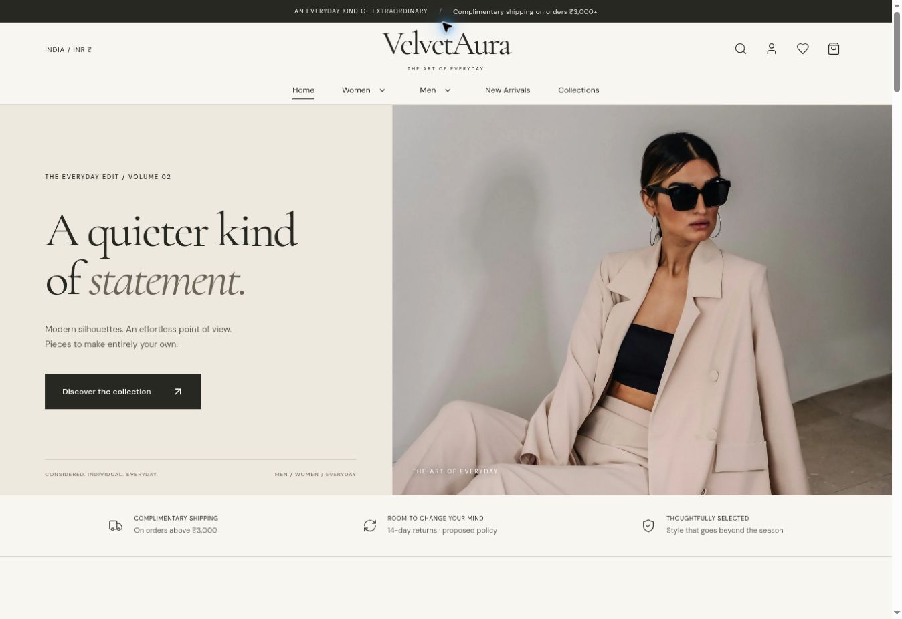

# VelvetAura 3.1 — implementation and verification report

Completed: 24 October 2026. Browser checks performed 23–24 October 2026. This release extends the existing React/Vite storefront. It does not replace the earlier authentication API or introduce checkout, payments or administration.

## Scope and retained architecture

React 19, Vite 6, React Router 7, Motion for React, Lucide and the existing CSS design system are retained. Existing product IDs, routes, local shopping state and authentication pages remain in place. Existing Express/MongoDB authentication code was not changed. The supplied references informed denser collection grids, compact headings, tall photographs and sidebar filters; VelvetAura's ivory, charcoal and beige identity remains original.

## Catalogue counts

**572 distinct products, including 560 new reference entries and all 12 original products. Each product belongs to exactly one subcategory. All 28 requested subcategories have at least 20 entries.** Department totals: Men 285; Women 287. Colour variants are not counted as additional products.

| Department | Subcategory | Products | Route |
| --- | --- | ---: | --- |
| Men | T-shirts | 21 | `/shop/men/t-shirts` |
| Men | Polo T-shirts | 20 | `/shop/men/polo-t-shirts` |
| Men | Casual Shirts | 21 | `/shop/men/casual-shirts` |
| Men | Formal Shirts | 20 | `/shop/men/formal-shirts` |
| Men | Linen Shirts | 21 | `/shop/men/linen-shirts` |
| Men | Jeans and Denim | 20 | `/shop/men/jeans-denim` |
| Men | Trousers and Chinos | 21 | `/shop/men/trousers-chinos` |
| Men | Shorts | 20 | `/shop/men/shorts` |
| Men | Hoodies and Sweatshirts | 20 | `/shop/men/hoodies-sweatshirts` |
| Men | Jackets and Outerwear | 21 | `/shop/men/jackets-outerwear` |
| Men | Co-ord Sets | 20 | `/shop/men/co-ord-sets` |
| Men | Ethnic and Occasion Wear | 20 | `/shop/men/ethnic-occasion` |
| Men | Formalwear | 20 | `/shop/men/formalwear` |
| Men | Accessories | 20 | `/shop/men/accessories` |
| Women | Tops | 20 | `/shop/women/tops` |
| Women | T-shirts | 20 | `/shop/women/t-shirts` |
| Women | Shirts and Blouses | 20 | `/shop/women/shirts-blouses` |
| Women | Dresses | 22 | `/shop/women/dresses` |
| Women | Jeans and Denim | 21 | `/shop/women/jeans-denim` |
| Women | Trousers | 20 | `/shop/women/trousers` |
| Women | Skirts | 20 | `/shop/women/skirts` |
| Women | Knitwear | 22 | `/shop/women/knitwear` |
| Women | Jackets and Outerwear | 22 | `/shop/women/jackets-outerwear` |
| Women | Co-ord Sets | 20 | `/shop/women/co-ord-sets` |
| Women | Ethnic and Occasion Wear | 20 | `/shop/women/ethnic-occasion` |
| Women | Activewear | 20 | `/shop/women/activewear` |
| Women | Loungewear | 20 | `/shop/women/loungewear` |
| Women | Accessories | 20 | `/shop/women/accessories` |

## Implemented behavior

- Sticky navigation with Men/Women mega-menus and accessible mobile category navigation.
- Editorial homepage, department banners, six category shortcuts, eight-item New Arrivals and Trending carousels, four-item favourites selection, brand story and newsletter.
- Independent department/subcategory routes, breadcrumbs and all 28 collection links. Original broad category and gender query links still work.
- Name/brand/keyword search; combined category, minimum/maximum price, size, colour and availability filters; popularity, newness and price sorting; reset/chips/empty states; 24-item pagination.
- Product cards with brand/category, INR price, colour indicators, wishlist and product-detail navigation. No invented original prices or sale percentages.
- Product details with valid size/colour selection, quantity limits, stock checks, enlargement dialog, genuine additional photos when available, details/care/SKU, related products and existing size guide.
- Bag drawer and full bag use the same store; additions, accumulated quantities and persisted entries respect variant stock. Saved entries reprice from catalogue data and invalid entries are removed. Wishlist and bag persist in localStorage.
- Responsive images, lazy loading, visible loading/error/empty feedback, native modal focus management and reduced-motion support.

## Image validation checklist and results

- [x] All 28 primary-photo contact sheets visually reviewed. Misclassified and near-identical selections replaced; photographed colours corrected in `catalogue-curation.json`.
- [x] 572 unique primary-photo hashes; no repeated primary asset across products.
- [x] Unique product IDs, SKUs, reference IDs, style identities and variant SKUs checked.
- [x] All 586 manifest entries resolve to local large/small assets: **1,172 WebP files decoded**, dimensions and hashes checked.
- [x] All **586 embedded per-photo fallback previews decoded** successfully.
- [x] Imported photographs were downloaded and decoded during import; rejected source failures did not enter the final seed.
- [x] Browser failure test: temporarily removed both derivatives for `va-20862244`; the product rendered its embedded photograph preview with a nonzero natural width. Both assets were immediately restored.
- [x] Gallery image switching and enlargement/Escape/focus restoration exercised in Chrome.

Four products have three genuine photographs: `va-18971858`, `va-17352294`, `va-13453254`, `va-18734674`. The remaining 568 use one primary photo plus enlargement; no repeated crops are presented as additional views.

Machine-readable results: [catalogue-validation.json](catalogue-validation.json). Source provenance: [catalogue-sources.json](../public/images/catalogue-sources.json). The audit validates every local image; browser viewport checks do not individually scroll every one of the 572 cards into view.

## Checks actually performed

### Automated

**`npm test`: 20 passed, 0 failed (24 October 2026).** The full image audit also passed on 24 October with no errors. The 20-test suite covers preserved shopping/auth helpers plus all category minimums, uniqueness, original product routes, pricing/variant/stock consistency, combined filters, pagination boundaries, invalid/overstock cart additions and safe persisted-cart migration.

Production build: **passed** on 24 October 2026 using the supported build helper (`npm run build`, Vite 6.4.4). No compilation errors. Main JavaScript: 1,680.27 kB minified / 461.94 kB gzip; CSS: 69.57 kB / 13.92 kB gzip. The large-chunk warning remains documented as a performance follow-up. `git diff --check` also passed.

### Browser — managed Chrome preview

- Opened every one of the 28 category routes and matched its displayed title/card count to the catalogue.
- Checked desktop Men/Women menu contents and route navigation; mobile menu expansion, category navigation and filter drawer application.
- Checked low-to-high price sorting, no-result search/reset and combined maximum-price + M-size + in-stock + Navy filters on dresses.
- Carousel forward/back controls moved the rail, and the forward control disabled at the final edge.
- Contact form rejected a missing required name, then validated a complete preview message and explicitly confirmed that nothing was sent.
- A fresh final browser run logged no application warnings/errors (extension messages excluded).
- Header search for `linen` reached 23 matching items; pagination advanced from items 1–24 to 25–48 of 572.
- Required a size before adding; selected XL and quantity 2; changed gallery photographs; added to bag and wishlist.
- Reload preserved the bag and wishlist. Quantity 2 subtotal was ₹3,198 with complimentary shipping; quantity 1 subtotal was ₹1,599, shipping ₹150, total ₹1,749. Removing items showed the empty states.
- Out-of-stock `va-20067402` disabled purchase; missing product and unknown route showed their respective 404 states.
- Enlargement dialog closed with Escape and returned focus to the image trigger. Newsletter accepted a valid preview address and explicitly stated that nothing was sent or stored.
- Layout overflow checks on Home, Shop, a gallery PDP, Collections, Cart and Wishlist at **320, 390, 768, 1024 and 1280 px iframe containers: 30/30 passed**. Content widths were 305/375/753/1009/1265 px after the scrollbar; scroll width matched content width in each case.

These are Chrome layout-container checks, not physical phone/tablet or Safari/Firefox certification. The browser extension emitted unrelated metadata warnings; these are distinct from application errors. The forced-image failure intentionally generated a missing-resource event.

## File map

| Files | Change |
| --- | --- |
| `src/data/categories.js`, `catalogue-seed.json`, `catalogue-curation.json`, `products.js` | Stable taxonomy, structured records, curation and preserved original IDs |
| `public/images/catalogue/`, `src/data/image-manifest.json` | Responsive local photographs and exact-photo embedded fallbacks |
| `public/images/catalogue-sources.json`, `scripts/build-catalogue.py` | Provenance and optional reproducible importer |
| `scripts/validate-catalogue.py`, `src/utils/catalogue.test.js` | Image audit and data/interaction logic tests |
| `Layout.jsx`, `Home.jsx`, `ProductCarousel.jsx`, `ProductCard.jsx`, `FashionImage.jsx` | Navigation, editorial discovery, carousels and shared cards/images |
| `Shop.jsx`, `ProductDetails.jsx`, `Cart.jsx`, `CartDrawer.jsx`, `App.jsx` | Routes, filters, gallery and shopping flows |
| `Store.jsx`, `StoreContext.js`, `shop.js`, `persistence.js` | Shared stock-aware shopping state and safe persistence |
| `src/styles/catalogue.css`, `editorial.css`, `src/main.jsx` | Responsive catalogue styles and image sizing |

## Run and reproduce

```sh
# Node.js 22.12+; project root
npm ci
npm run dev
npm test
npm run build
npm run preview

# Optional full local image audit, with Python + Pillow installed
python scripts/validate-catalogue.py
```

No download/import is needed to run or build; the final assets and records are committed. To recreate a catalogue import, see the script's `--help` and provenance file. The importer is an optional maintenance tool, not a runtime dependency.

## Limits and next phase

- Product prices, sizes, stock, popularity/newness ranks and merchandising flags are demo data, clearly identified in the storefront. They are not live retail inventory, genuine sales rankings or an offer to sell.
- Source brands are retained for attribution. Reference data came from the public Myntra products dataset (Ronak Bokaria, Kaggle) and the `pazhanir/product-images` reference repository. Public availability does not establish commercial image rights; obtain permission or replace photos with owned/licensed imagery before commercial launch.
- Men's co-ord selections include matching casual/lounge and tracksuit sets. Colour variants of the same design were deduplicated; no attempt is made to represent every possible retailer variant.
- Size and care specifications are illustrative. The retained general size guide is not a manufacturer-specific measurement chart and does not cover every numeric/extended size in the seed.
- Existing API/auth source is preserved, but a live API, MongoDB and SMTP were not provisioned or retested in this phase. Hosted account services remain explicitly unconfigured. Earlier auth test evidence is in `VALIDATION.md`.
- Backend catalogue/cart/wishlist sync, customer orders, checkout, payments, administration and server-authoritative inventory/prices remain future work. Contact/newsletter validate locally and do not deliver messages.
- The catalogue and embedded previews increase the initial JavaScript bundle. Vite reports its chunk-size warning; route/data splitting and measured network/Lighthouse profiling remain performance follow-up work. Large product images themselves are responsive and lazy-loaded, with only 24 cards on a collection page.

## Database migration preparation

Keep product `id`/`sku` and category `id` stable. Import product metadata into Product, category rows into Category, and each `{sku, size, color, stock}` entry into a unique variant record. Copy owned/licensed assets to object storage and retain image/provenance metadata. Replace seed reads with a paginated API and move inventory, price, discount and order calculations to the server; browser values must not become authoritative. Migrate local bag/wishlist entries by product and variant identifiers after explicit account sign-in. The existing auth API can then protect customer resources without creating another authentication system.

## Rendered preview


